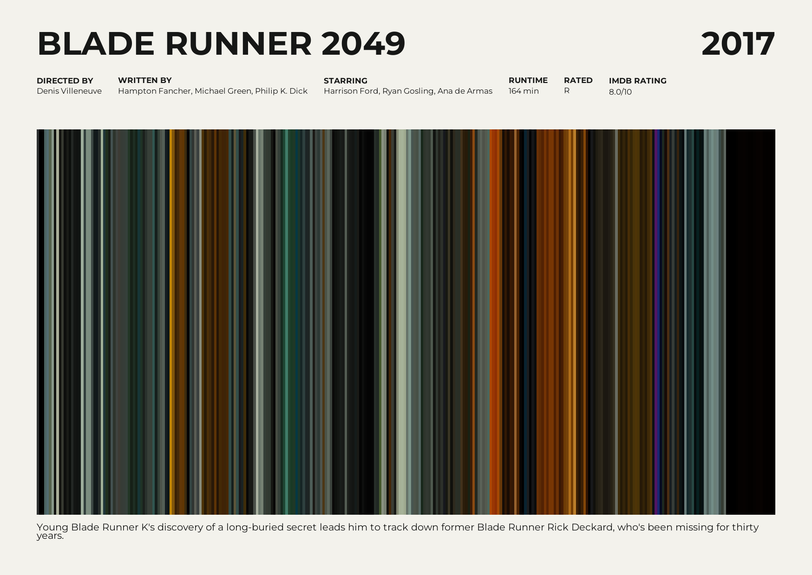
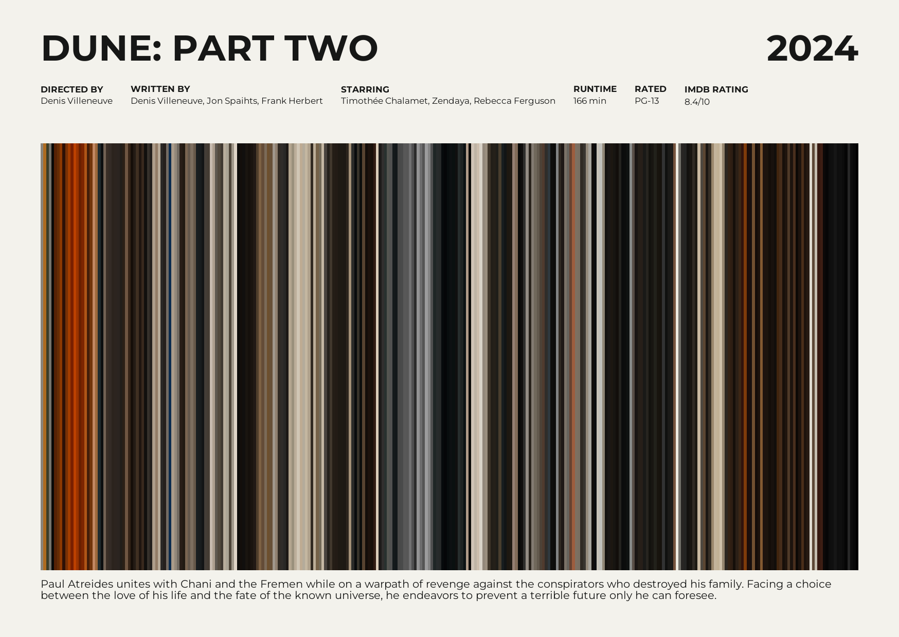
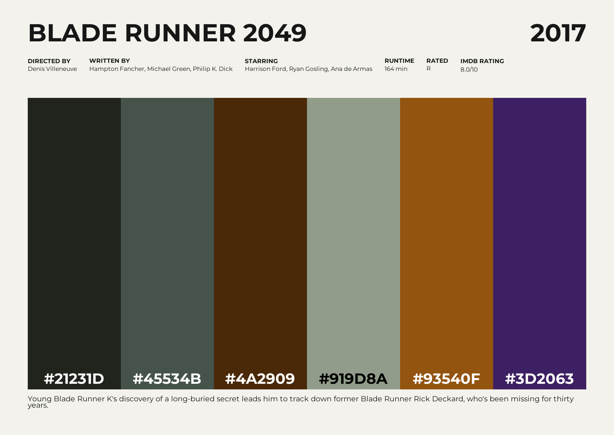
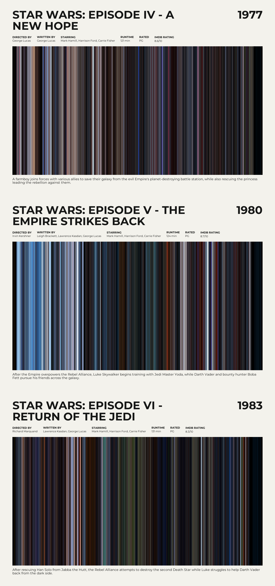

# Reelcard

[](https://github.com/colinmakerofthings/reelcard-cli/actions/workflows/tests.yml)

Reelcard is a local command-line tool for turning a video into a postcard-sized
film-barcode print. It samples frames in chronological order, calculates a
representative colour for each, and arranges the colours as vertical stripes
within a carefully typeset poster.

> **First stable release:** [v1.0.0](https://github.com/colinmakerofthings/reelcard-cli/releases/tag/v1.0.0).

## Example posters

### Blade Runner 2049



Created from one movie file with an IMDb lookup:

```console
reelcard "Z:\Movies\Blade Runner 2049 [2017].mp4" --imdb-id tt1856101
```

### Dune: Part Two



Created from one movie file with an IMDb lookup:

```console
reelcard "Z:\Movies\Dune Part Two [2024].mp4" --imdb-id tt15239678
```

## Requirements

- Python 3.11 or newer.
- FFmpeg and FFprobe available on your `PATH`.

FFmpeg and FFprobe are separate system programs; installing the Python package
will not install them. Install FFmpeg using a trusted package manager for your
operating system, then check that both `ffmpeg -version` and
`ffprobe -version` work in a new terminal. For example, Windows users can use
`winget install Gyan.FFmpeg` or `choco install ffmpeg`, macOS users can use
`brew install ffmpeg`, and Debian/Ubuntu users can use
`sudo apt install ffmpeg`.

## Installation

Install the stable v1.0.0 release
from source:

```console
git clone --branch v1.0.0 --depth 1 https://github.com/colinmakerofthings/reelcard-cli.git
cd reelcard-cli
python -m venv .venv
```

Activate the environment, then run:

```console
python -m pip install --upgrade pip
python -m pip install .
```

## Usage

Examples:

```console
reelcard "My Film.mp4"
reelcard "My Film.mp4" --title "My Film" --year 1994 --stripes 600
reelcard "My Film.mp4" --output "my-film-postcard.png" --director "A. Director"
reelcard "My Film.mp4" --format svg
reelcard "My Film.mp4" --color-style brighter --force
reelcard "My Film.mp4" --color-style vivid --force
reelcard "My Film.mp4" --imdb-id tt0087182
reelcard "My Film.mp4" --palette
reelcard "My Film.mp4" --background-color white
reelcard "My Film.mp4" --background-color "#e8dfc8"
reelcard --series "my-series.json" --output "my-series.png"
```

The input filename supplies the title when `--title` is omitted. By default,
Reelcard writes a sanitized title-based PNG into the current directory and
refuses to replace an existing file. Use `--force` to replace it.

Run `reelcard --help` for all options:

| Option | Description |
| --- | --- |
| `--title TEXT` | Poster title; defaults to the video filename. |
| `--year YEAR` | Optional release year from 1 to 9999. |
| `--director TEXT` | Optional director credit. |
| `--writer TEXT` | Optional writer credit. |
| `--starring TEXT` | Optional lead cast. |
| `--runtime TEXT` | Runtime label (e.g. `122 min`); overrides IMDb and video runtime. |
| `--rating TEXT` | MPAA rating shown with the other metadata. |
| `--imdb-rating TEXT` | IMDb score shown without its vote count. |
| `--plot TEXT` | Plot summary shown in the footer. |
| `--subtitle TEXT` | Optional subtitle below the barcode. |
| `--credits TEXT` | Optional footer credits. |
| `--background-color COLOR` | Poster background: `white` (default), `paper`, or a six-digit hex color. |
| `--imdb-id ID` | Look up missing metadata for this movie via OMDb; requires an API key. |
| `--series PATH` | Create one stacked poster from a JSON movie-series manifest. |
| `--palette` | Show up to six film colors in the poster's barcode area. |
| `--include-black` | Include near-black colors in palette mode (excluded by default). |
| `--output PATH` | Output destination; extension must match the selected format. |
| `--format FORMAT` | Output format: `png` (default) or `svg`. |
| `--stripes N` | Number of sampled frames/stripes (default 300; maximum 10000). |
| `--color-style STYLE` | Barcode colors: `natural` (default), `brighter`, or `vivid`. |
| `--size postcard` | Named print-size preset (the default). |
| `--width PX --height PX` | Custom landscape output dimensions; specify both. |
| `--dpi DPI` | Print-resolution metadata (default 300). |
| `--force` | Allow replacing an existing output file. |

The postcard preset is approximately 148 × 105 mm at 300 DPI (1748 × 1240
pixels). FFmpeg and FFprobe process the video locally. Reelcard does not
contact an online movie database unless metadata lookup is explicitly enabled.
Barcode colors are calculated from the brighter 75% of each sampled frame,
reducing shadow bias without an artificial brightness lift.

Use `--color-style brighter` for a moderate brightness lift or `--color-style
vivid` to increase color saturation. The default `natural` style keeps the
original sampled colors. Use `--force` to replace the same output while
comparing styles.

### Color-palette posters

Use `--palette` to replace the barcode with up to six horizontal color swatches
while keeping the normal poster layout, including movie title, year, and any
available IMDb metadata. Each swatch is labeled with its hexadecimal color
value, using black or white text for contrast:

```console
reelcard "My Film.mp4" --palette --imdb-id tt0087182
reelcard "My Film.mp4" --palette --include-black --imdb-id tt0087182 --format svg
```

The Blade Runner 2049 example, with its IMDb details and palette colors:



```console
reelcard "Z:\Movies\Blade Runner 2049 [2017].mp4" --palette --imdb-id tt1856101
```

Planning a Blade Runner 2049-themed bedroom? You're covered: print the palette,
pick a wall color, and supply your own neon rain.

Reelcard samples each selected frame as a small color grid, groups the combined
pixels in CIELAB perceptual color space, and orders the resulting swatches by
prominence. Near-black pixels (maximum RGB channel 24 or below) are excluded by
default so dark scenes do not overwhelm the palette. Use `--include-black` when
dark tones are important to the film. Palette posters support both PNG and SVG;
the standard barcode poster remains the default.

### Movie series

Create a JSON manifest with each movie's path and either a release year or an
IMDb ID. Paths are relative to the manifest file. IMDb IDs let Reelcard look
up missing metadata and release years through OMDb:

```json
{
  "movies": [
    {
      "path": "a-new-hope.mp4",
      "imdb_id": "tt0076759"
    },
    {
      "path": "the-empire-strikes-back.mp4",
      "imdb_id": "tt0080684"
    },
    {
      "path": "return-of-the-jedi.mp4",
      "imdb_id": "tt0086190"
    }
  ]
}
```

Example output: the Star Wars trilogy, with each movie in its own chronological
panel:



[View the vector SVG version](assets/star-wars-trilogy.svg).

Generate the PNG from the example manifest:

```console
reelcard --series examples\star-wars-trilogy.json
```

Or create the vector version:

```console
reelcard --series examples\star-wars-trilogy.json --format svg --output assets\star-wars-trilogy.svg --force
```

Run `reelcard --series "star-wars.json"`. Panels are ordered from oldest to
newest by year; entries with the same year retain their manifest order. Set
`OMDB_API_KEY` to enable IMDb lookups. A movie can provide `year` instead of
`imdb_id`, or provide both to use the manifest year while still looking up
other metadata. Explicit metadata fields take precedence over OMDb values.
Supported fields are `title`, `year`, `imdb_id`, `director`, `writer`,
`starring`, `runtime`, `rating`, `imdb_rating`, `plot`, `subtitle`, and
`credits`. Titles default to the OMDb title when available, otherwise the video
filename. If a lookup cannot supply a missing year, Reelcard reports an error
instead of guessing the series order. `--stripes` and `--color-style` apply to
each movie. `--width` and `--height` set each panel's dimensions, so the final
image is stacked vertically. The combined height is limited to 20000 pixels.
Series mode supports both PNG and SVG; per-movie metadata options on the
command line should instead be placed in the manifest.

## Optional metadata lookup

Manual mode is the default and does not make network requests. To look up
metadata for a specific movie, obtain an OMDb API key, set it in the
`OMDB_API_KEY` environment variable, and pass the movie's IMDb ID with
`--imdb-id`.

Lookup fills the title, year, director, writer, and starring fields only when
they were not supplied manually. Runtime uses the manually supplied value
first, then OMDb's runtime, then the duration read from the video. The MPAA
rating, IMDb score, and plot also come from OMDb unless supplied manually.
Subtitle and credits remain manual. Missing credentials, network problems,
and lookup failures produce a warning and Reelcard continues with manual
values and defaults.

## Output

Reelcard exports PNG images with print-resolution metadata by default. Choose
`--format svg` for an SVG with vector text and background; the barcode itself
is drawn as vector rectangles too. The SVG embeds the Montserrat font so the
typography remains consistent on computers without that font installed. Its
physical dimensions use the selected DPI. Video metadata is read locally using
FFprobe, and selected frames are decoded by FFmpeg.

## Supported platforms and limitations

Reelcard is designed for Windows, macOS, and Linux. FFmpeg and FFprobe must be
installed separately, and codec support depends on the FFmpeg build and input
video. Movie credits and other poster details must be entered manually; Reelcard
can optionally look up some fields through OMDb when requested. Frame sampling
decodes the video in a single FFmpeg process but can still take time for long
videos or high stripe counts.

## Development

Install the development dependencies instead of the runtime-only package:

```console
python -m pip install -e ".[dev]"
```

Run the test suite from the repository root with coverage reporting:

```console
python -m pytest --cov=reelcard --cov-report=term-missing
```

## Licence

Reelcard is distributed under the MIT License; see [LICENSE](LICENSE).
The bundled Montserrat font is licensed under the SIL Open Font License 1.1;
see [the font licence](src/reelcard/fonts/Montserrat-OFL.txt).
